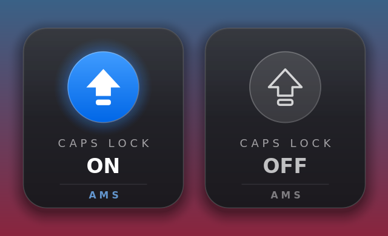

# AMS Caps Lock OSD — Software (PC)

Shows a clean popup that fades in and out whenever **Caps Lock** is turned **ON or OFF**. Lives in the tray and starts with Windows.



| | |
|---|---|
| Install | [`release/AMS-CapsLockOSD-Setup.exe`](release/AMS-CapsLockOSD-Setup.exe) |
| Portable exe | [`release/CapsLockOSD.exe`](release/CapsLockOSD.exe) |
| Promo video | [`promotional-video/ams-capslock-osd/`](../../../promotional-video/ams-capslock-osd) |
| Blog post | [`blogger/ams-capslock-osd/post.md`](../../../blogger/ams-capslock-osd/post.md) |
| Version | 1.1.0 |

## Install (users)
1. Run **`release/AMS-CapsLockOSD-Setup.exe`** (no admin rights needed).
2. Click **Next → Install → Finish**. The app starts and the AMS YouTube channel opens once.
3. It **starts automatically with Windows** from now on.

> SmartScreen may show "Windows protected your PC" because the exe isn't code-signed. Click **More info → Run anyway**.

### Use
- Press **Caps Lock**. The AMS popup fades in near the bottom of the screen and fades out after about 1.5 s.
- Tray icon: blue = ON, grey = OFF. Left-click shows the popup. Right-click gives **Start with Windows**, **Show preview**, **AMS on YouTube** and **Exit**.

### Uninstall
Settings → Apps → **AMS Caps Lock OSD** → Uninstall (the YouTube channel opens once when it finishes).

## Files
| Path | What |
|---|---|
| `src/Program.cs` | Complete app source: tray, keyboard hook, layered popup window, drawing, start-with-Windows option |
| `tools/Gen.cs` | Renders the app icon PNGs and preview images with the same drawing code |
| `installer/installer.nsi` | NSIS installer (per-user, AMS branding, YouTube on finish) |
| `assets/` | `app.ico`, icon PNGs, installer banners `wizard.bmp` (164×314) and `header.bmp` (150×57), preview |
| `build_linux.sh` | Builds everything on Linux (mono + nsis + imagemagick) |
| `build.bat` | Rebuilds the exe on Windows using the built-in .NET compiler |
| `release/` | Ready-to-ship `CapsLockOSD.exe` and `AMS-CapsLockOSD-Setup.exe` |

## Build
```bash
../../../engine/setup/setup_linux.sh     # once
./build_linux.sh                         # -> release/
```
On Windows: double-click `build.bat` (exe only). For the installer, install NSIS and run `makensis installer\installer.nsi`.

## Build history (how it was made)
1. **v1.0**: Caps Lock popup app with fade-in/out, tray icon, start with Windows, NSIS installer.
2. **v1.1**: AMS branding (app name, popup footer, tray menu, installer banners, publisher) and opens the YouTube channel once after install and once after uninstall.
3. **Video + post**: 65s commercial promo in the AMS 7-scene style, plus the blog post.

## Decisions
| Decision | Why |
|---|---|
| C# WinForms on **.NET Framework 4.x** | Built into every Windows 10/11 PC: no runtime download, small exe (~130 KB). |
| Cross-compiled on Linux with **Mono `mcs`** | No Windows machine needed to build; the output runs on Microsoft .NET. `build.bat` can also rebuild on Windows with the built-in `csc.exe`. |
| **Layered window** (`UpdateLayeredWindow`) with per-pixel alpha | Smooth anti-aliased rounded card, soft shadow, real fade, so it looks professional. |
| Window styles: `TRANSPARENT`, `NOACTIVATE`, `TOOLWINDOW`, `TOPMOST` | Click-through, never takes focus, not shown in Alt-Tab, always on top. |
| **Keyboard hook + 150 ms polling** | The hook gives an instant reaction; polling catches changes the hook can miss (e.g. when an elevated app has focus). |
| Single instance (named mutex) | Prevents two copies from running at once. |
| DPI-aware, shows on the monitor where the mouse is | Stays sharp on high-resolution screens and works with multiple monitors. |
| Per-user install (HKCU, `%LOCALAPPDATA%`) | **No admin rights** and no UAC prompt. |
| Start with Windows via the HKCU `Run` key | Simple and reliable; can be turned on/off from the tray menu. |
| Opens YouTube in `.onInstSuccess` / `un.onUninstSuccess` | Fires exactly once, after the user clicks Finish. |

## Tunables (in `src/Program.cs`)
- Timing: `FadeInMs = 170`, `HoldMs = 1100`, `FadeOutMs = 420`
- Position: `wa.Bottom - height - 70*scale` (bottom-centre above the taskbar)
- Size: card `176 × 198` × DPI scale
- Colors: `Accent1 #409CFF`, `Accent2 #0066E6`
